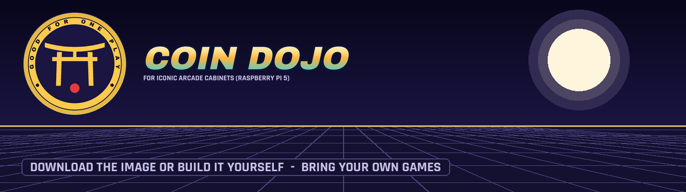
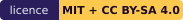
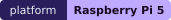
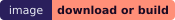
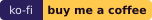
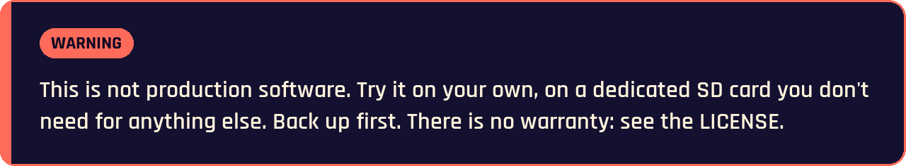
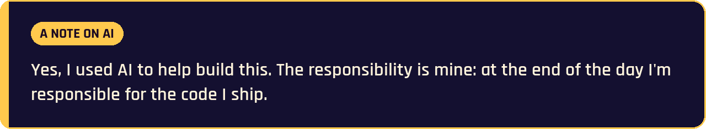
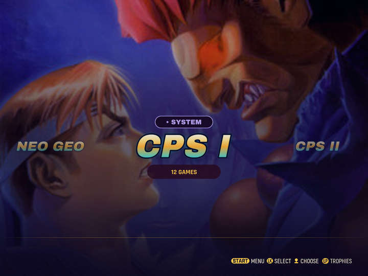
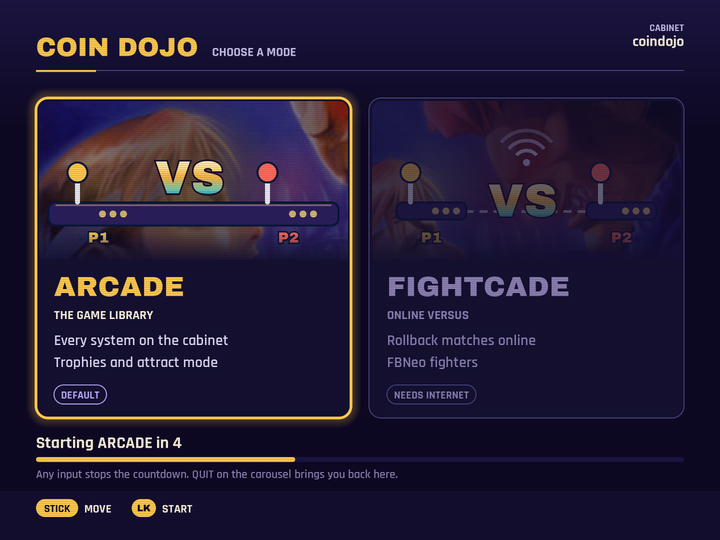
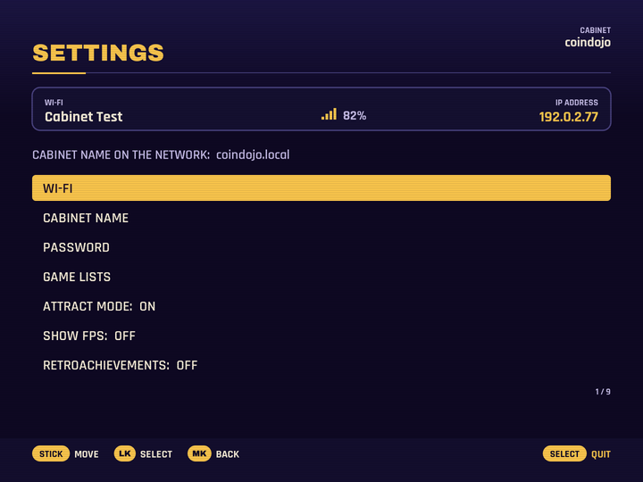

# Coin Dojo

   

Coin Dojo is an arcade OS for Iconic Arcade cabinets (Raspberry Pi 5): it turns the cabinet into a ready-to-play
arcade, run with the stick alone. Configured for and tested on the Iconic Arcade hardware: its Raspberry Pi 5,
the six-button panel, the screen and the bezel. Not affiliated with or endorsed by Iconic Arcade. Other
Raspberry Pi 5 setups may work but are untested.

**New here? [Start here](docs/START.md)**: download the card image, write it to a microSD card, play. No typing.
Or read it as a retro instruction booklet: [the booklet](docs/manual/README.md), page by page, ready to print.
Building the image yourself is optional.

> **Warning.** This is not production software. Try it on your own, on a dedicated SD card you don't need for
> anything else. Back up first. There is no warranty: see the LICENSE.

> **A note on AI.** Yes, I used AI to help build this. The responsibility is mine: at the end of the day I'm
> responsible for the code I ship.

> **Platform: tested on macOS (Apple Silicon) so far**, for building the image yourself. Linux: the build is
> written for it but not tested yet (#237). Windows: coming after Thanksgiving. Playing needs none of this.

## What you get

- **A game menu** that shows only the systems you have games for, with box art, videos and MUST PLAY lists.
- **A boot menu**: ARCADE for your games, or FIGHTCADE for online matches against real people.
- **Online play** with Fightcade, signed in and chatting with the stick alone: an on-screen keyboard and chat shortcuts.
- **SETTINGS on the stick**: Wi-Fi, password, game lists, attract mode and more. No keyboard needed.
- **A network folder**: drag games from your Mac or Windows PC onto the cabinet. No card reader.
- **Box art and game info** that the cabinet fetches by itself ([how](docs/SCRAPING.md)).
- **Trophies** from RetroAchievements, a CRT look, and one combo to leave any game: **SELECT+START**.
- **No games included.** You bring your own, copied from cartridges or discs you own.

| Game menu | Boot menu | SETTINGS |
|---|---|---|
|  |  |  |

## What you need

- A Raspberry Pi 5 arcade cabinet, for example an Iconic Arcade cabinet.
- A microSD card of 16 GB or more that you don't need for anything else.
- A computer on the same home network, and your own games.

## Start in 3 steps

1. **Download** the card image. The link is in [the start guide](docs/START.md).
2. **Write it** to a microSD card with Raspberry Pi Imager, put the card in the cabinet and switch on.
3. **Add your games** from your computer through the network folder, and play.

Then change the password 12345 in **SETTINGS**, **PASSWORD**. Every click, step by step: [docs/START.md](docs/START.md).

## The SETTINGS pages

On the game menu, turn the stick to **SETTINGS** and press **LK**. **MK** goes back, **SELECT** leaves.

| Page | What it does |
|---|---|
| WI-FI | join your home Wi-Fi |
| CABINET NAME | the name your computer sees on the home network |
| PASSWORD | change the password 12345 (you type the new one twice) |
| GAME LISTS | rebuild MUST PLAY and the other lists; MUST PLAY size and minimum stars |
| ATTRACT MODE | the show the cabinet puts on when nobody plays: on or off, when, and what |
| SHOW FPS | show the game's speed on screen |
| RETROACHIEVEMENTS | log in, trophies on or off, casual or hardcore |
| TIME ZONE | your clock |

## Documentation

| I want to... | Read |
|---|---|
| Set up my cabinet, no terminal (start here) | [docs/START.md](docs/START.md) |
| Know which folder a game goes in, and the BIOS files | [docs/ROMS.md](docs/ROMS.md) |
| Play online: sign in, find a match | [docs/FIGHTCADE.md](docs/FIGHTCADE.md) |
| Get box art and game info (scraping) | [docs/SCRAPING.md](docs/SCRAPING.md) |
| Fix a problem | [docs/FAQ.md](docs/FAQ.md) |
| Look up a button combo | [docs/REFERENCE.md](docs/REFERENCE.md) |

## Fork it, make it yours

Coin Dojo is free and non-commercial. Take it and make it yours: your own theme
([themes/README.md](themes/README.md)), your own game lists, your own cabinet. Pull requests are welcome
([CONTRIBUTING.md](CONTRIBUTING.md)).

Questions, ideas, bugs, or just a thank-you: open an issue on the project's repo.

**[Buy me a coffee on Ko-fi](https://ko-fi.com/y4s1n).** Tips are voluntary and unlock nothing: no play, no feature, no emulator or game.

## For advanced builders

Build the image yourself, or keep a running cabinet up to date over SSH from your computer:
[docs/BUILD.md](docs/BUILD.md) (with [a beginner path on a Mac](docs/BUILD.md#start-here-the-beginner-path-on-a-mac)).

| I want to... | Read |
|---|---|
| See how it all fits (diagrams of the build and the deploy) | [docs/HOW-IT-WORKS.md](docs/HOW-IT-WORKS.md) |
| Build an image, flash it, first boot | [docs/BUILD.md](docs/BUILD.md) |
| Deploy over SSH from a Mac | [docs/SETUP.md](docs/SETUP.md) |
| Know why it is set up this way, with the numbers | [docs/TUNING.md](docs/TUNING.md) |
| Look up a make target, a config variable | [docs/REFERENCE.md](docs/REFERENCE.md), [docs/CONFIG.md](docs/CONFIG.md) (generated) |
| Find upstream projects and licences | [docs/RESOURCES.md](docs/RESOURCES.md) |
| Try a change in the test VM | [vm/README.md](vm/README.md) |
| Know what changed | [CHANGELOG.md](CHANGELOG.md) |
| Work as an agent in this repo | [AGENTS.md](AGENTS.md) |

What runs on the cabinet:

| Piece | What |
|---|---|
| Board | Raspberry Pi 5, 2 GB |
| OS | Raspberry Pi OS Lite arm64 (Debian 13, trixie), 4 KB-page kernel (`kernel8.img`, for emulator JITs) |
| Storage | one SD card: `/` system, `/data` games, BIOS, saves, media, emulators |
| Session | a boot menu (ARCADE or FIGHTCADE) inside `cage`, a Wayland kiosk |
| Game menu | ES-DE 3.5.0, theme Coin Dojo |
| Emulators | RetroArch 1.22.2, a GLES N64 core, standalone flycast 2.7 for Dreamcast/NAOMI |
| Online play | Fightcade 2.1.45 on arm64 Electron 9.1.0, its FBNeo under Box64 0.4.4 + Wine 10.0 |
| Access | SSH key only |

Where things live (the style kit's rules: [brand/BRAND.md](brand/BRAND.md); `make help` lists every target and
wins over any doc):

| Path | What |
|---|---|
| `ansible/`, `skills/` | the deploy ([ansible/README.md](ansible/README.md)); workflows and their code ([skills/README.md](skills/README.md)) |
| `themes/` | the game menu theme; its night backdrop is credited in [THIRD_PARTY.md](THIRD_PARTY.md) |
| `build/`, `config/` | emulator builds in arm64 containers; config variables |
| `tools/`, `mk/`, `ci/`, `tests/` | make rules, CI, team tooling ([tools/README.md](tools/README.md)) |
| `personal/` | private art and values, never exported (not in this repo) |

## Licences

| What | Licence |
|---|---|
| Code | MIT ([LICENSE](LICENSE)) |
| Original art and docs | CC BY-SA 4.0 ([LICENSE-art](LICENSE-art)) |
| Fonts | their own ([NOTICE](NOTICE)) |
| Upstream software you install | its own: [docs/RESOURCES.md](docs/RESOURCES.md) |
