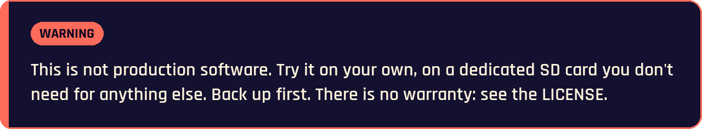

# Build, flash and first boot



> **Warning.** This is not production software. Try it on your own, on a dedicated SD card you don't need for
> anything else. Back up first. There is no warranty: see the LICENSE.

> **Platform: tested on macOS (Apple Silicon) so far.** Linux: the build is written for it but not tested yet
> (#237). Windows: coming after Thanksgiving.

This guide turns a fresh clone into a bootable SD card for the Raspberry Pi 5 of an Iconic Arcade cabinet. Coin
Dojo is built for the Iconic Arcade Street Fighter Alpha 2 cabinet, and tested on it; the Street Fighter II cabinet is
the same hardware (not affiliated with or endorsed by Iconic Arcade or Capcom). Most
owners don't need it: [download the image](START.md) instead. Nothing is downloaded ready-made:
you build the image on your own computer from the official Raspberry Pi OS Lite image, then flash it.
**Never used Terminal? Start with [the beginner path on a Mac](#start-here-the-beginner-path-on-a-mac).** The
numbered sections after it are the detailed reference (Linux too). Run every command from the repo root.
`make help` lists every target and flag and wins over this page. Build details:
[skills/build-image/SKILL.md](../skills/build-image/SKILL.md).

## Contents

- [Start here: the beginner path on a Mac](#start-here-the-beginner-path-on-a-mac)
  - [If something goes wrong (beginner path)](#if-something-goes-wrong)
- [What you need](#what-you-need)
- [SD card sizes](#sd-card-sizes)
- [1. Get the base image](#1-get-the-base-image)
- [2. Build the image](#2-build-the-image)
- [3. Back up the card first](#3-back-up-the-card-first)
- [4. Flash](#4-flash)
- [5. First boot](#5-first-boot)
- [What the image gives today](#what-the-image-gives-today)
- [6. Add your games](#6-add-your-games)
- [7. The full cabinet: deploy](#7-the-full-cabinet-deploy)
- [When something goes wrong (detailed reference)](#when-something-goes-wrong)

## Start here: the beginner path on a Mac

No Terminal or programming experience needed. You copy one command at a time into Terminal, press Return, and
check that you see what the step says. The first time takes about an hour, most of it waiting for downloads
and for the emulators to build (step 10).

**You need:**

- A Mac with Apple Silicon (M1 or newer). To check: Apple menu > About This Mac, the "Chip" line says Apple M...
- About 20 GB of free disk space: the build needs about 9 GB (it checks this itself), the Raspberry Pi OS
  download takes about 3.5 GB (measured 2026-11-19), and Colima's virtual disk grows as Docker stores things in
  it (not measured for this build: leave a few GB for it).
- An internet connection, an SD card reader, and an SD card of **16 GB or more that you don't need for anything
  else** (32 GB recommended). It is wiped.
- A Raspberry Pi 5 with a screen (HDMI) and a stick or USB gamepad.

**How to read this guide.** A grey box is a command. Copy the whole box, click in the Terminal window, paste
(Command-V) and press Return. Wait until the line ending in `%` comes back before you go on.

### What is make?

`make` runs a recipe. This project comes with a recipe book (a file called `Makefile`): you type `make image` and
it does all the build steps for you, in the right order. Every `make ...` line below is one recipe. More, in plain
words: [Make (software) on Wikipedia](https://en.wikipedia.org/wiki/Make_%28software%29).

### Part A: one-time setup

**Step 1. Open Terminal.** Press Command-Space (Spotlight), type `Terminal`, press Return. Or in Finder, open
Applications, then Utilities, then Terminal. A window opens with a line that ends in `%`: you paste the commands
there. Apple's own steps: [Open or quit Terminal on Mac](https://support.apple.com/guide/terminal/open-or-quit-terminal-apd5265185d-f365-44cb-8b09-71a064a42125/mac).

**Step 2. Install Apple's command line tools.** They include `make` and `git`.

```
xcode-select --install
```

A window asks whether to install the tools: click **Install** and wait until it says the software was installed
(several minutes). If Terminal instead prints `Command line tools are already installed`, you have them: go on.

**Step 3. Install Homebrew**, a free installer for command line programs ([brew.sh](https://brew.sh/)):

```
/bin/bash -c "$(curl -fsSL https://raw.githubusercontent.com/Homebrew/install/HEAD/install.sh)"
```

It says what it will do, then waits: press Return, and type your Mac password when asked (nothing shows while you
type; that is normal). At the end it prints **Next steps** with a few commands: copy and run those too. Then quit
Terminal (Command-Q) and open it again. Check: `brew --version` prints `Homebrew` and a version number.

**Step 4. Install Docker with Colima.** The build runs inside Docker containers; Colima runs Docker on a Mac. It
is the setup the build was tested with (#237).

```
brew install colima docker
```

Other way: Docker Desktop, free for personal use
([install Docker Desktop on Mac](https://docs.docker.com/desktop/setup/install/mac-install/)). The build supports
it, but it is not tested yet. Install one of the two, not both.

**Step 5. Start Docker.**

```
colima start --cpu 6 --memory 12
```

This gives Docker 6 CPUs and 12 GB of memory, the setup the build was tested with (#237). Smaller Mac? Fewer
CPUs or less memory (for example `colima start --cpu 4 --memory 6`) may work but is not tested yet. The first
start takes a minute or two. Check: `colima status` prints `colima is running`. After you restart your Mac, run
`colima start` again before you build (it keeps the CPU and memory you chose).

**Step 6. Download the project** into your home folder.

**The public address is not out yet: TBD (#234). Until then, use the address you were given.** In the second line
below, replace the whole `PASTE-THE-ADDRESS-YOU-WERE-GIVEN-HERE` (it is not a real address) with that address,
then run both lines:

```
cd ~
git clone PASTE-THE-ADDRESS-YOU-WERE-GIVEN-HERE coin-dojo
```

Check: Terminal prints `Cloning into 'coin-dojo'...` and no `fatal:` line.

**Step 7. Go into the project folder.** Every later command runs from here. If you close Terminal, open it again
and run this line first.

```
cd ~/coin-dojo
```

**Step 8. Install the settings reader** (one time; a small Python add-on the build needs):

```
make config-venv
```

Check: the last line says `config-venv: ... ready (PyYAML installed)`.

### Part B: build the image

**Step 9. Download Raspberry Pi OS Lite** (about 525 MB, checked against a pinned checksum):

```
make base-image
```

Done looks like this last line (`<you>` is your Mac user name):

```
BASE_IMG=/Users/<you>/.cache/coin-dojo/base-image/2026-10-06-raspios-trixie-arm64-lite.img
```

**Step 10. Build your image.** First, one time, build the emulators the image gets (RetroArch, the N64 core,
flycast, Stella; about 15 minutes, many lines scroll by):

```
make -C build all
```

Then the other eight game cores, built from pinned source (hours: MAME alone takes most of it):

```
make -C build cores
```

You can skip that for your own cabinet: the image build then downloads those cores from libretro instead, with a
warning per core. A release image needs them built.

Now build the image: copy all three lines at once (the `\` at a line end means "continues below"):

```
make image \
  BASE_IMG=$HOME/.cache/coin-dojo/base-image/2026-10-06-raspios-trixie-arm64-lite.img \
  IMAGE_OUT=$HOME/coindojo/coindojo.img
```

About 6 to 8 minutes on the tested Mac (341 s and 478 s, #244, 2026-11-19, measured with Fightcade mode on;
the default image skips Fightcade). The first run can take longer (downloads). Lines starting with `==` (the steps) and
`PASS` scroll by. Lines saying there is no first-boot config, or a `WARN` about a Keychain item, are fine: your
settings go on the card in Part D. Done looks like this last line:

```
DONE -> /Users/<you>/coindojo/coindojo.img (EDITION=community, 8200 MiB, sha256 ... in coindojo.img.sha256, ...s)
```

Your image is `coindojo.img` in the `coindojo` folder of your home folder. If the build stops with a line that
starts with `ERROR:`, that line says what to fix: see [If something goes wrong](#if-something-goes-wrong).

### Part C: write the image to the SD card

Use **Raspberry Pi Imager**, the official free tool. Download it from
<https://www.raspberrypi.com/software/> ("Download for macOS"), open the downloaded file and drag Raspberry Pi
Imager to Applications.

1. Put the SD card in the reader, then open Raspberry Pi Imager.
2. **Device:** Raspberry Pi 5.
3. **OS:** scroll to the bottom and choose **Use custom**. Pick `coindojo.img` (in your home folder, then
   `coindojo`; Command-Shift-G and `~/coindojo` jumps there).
4. **Storage:** your SD card. Check that the size matches your card: whatever you pick here is erased. Keep
   "Exclude system drives" on.
5. When Imager offers to customise the OS (user, Wi-Fi, SSH), choose **Skip customisation** (older Imager
   versions: **No**). Those settings do not reach this image (#247), and an older Imager's user name would rename
   the cabinet's own user, so the cabinet would not start (#244). Yours go in a file in Part D.
6. Write, and confirm that the card will be erased. Your Mac may ask for your password. Imager writes, then
   verifies the card. When it says it is finished, take the card out.

Comfortable with Terminal and want `dd` instead? See [4. Flash](#4-flash) (and back the card up first:
[3. Back up the card first](#3-back-up-the-card-first)).

### Part D: your settings file (Wi-Fi, SSH key)

The card has a small partition named `bootfs` that a Mac can open. Your settings go in a file there called
`coindojo.yml`. Everything in it is optional: without it the cabinet still boots and plays.

**Step 11. Make an SSH key** (it lets your Mac copy games to the cabinet later; one time):

```
ssh-keygen -t ed25519
```

Press Return at each question. If it says the file already exists and asks to overwrite, type `n`: you already
have a key.

**Step 12. Put the card back in the reader.** Finder shows a disk named `bootfs`. If your Mac says a disk is not
readable, click **Ignore**, never **Initialize** (that erases the card): the games partition uses a Linux format
the Mac cannot open, which is expected.

**Step 13. Copy the example settings onto the card** (from `~/coin-dojo`):

```
cp skills/build-image/coindojo.example.yml /Volumes/bootfs/coindojo.yml
```

**Step 14. Copy your SSH key to the clipboard:**

```
pbcopy < ~/.ssh/id_ed25519.pub
```

**Step 15. Fill in the settings.** This opens the file in TextEdit:

```
open -e /Volumes/bootfs/coindojo.yml
```

If TextEdit shows a formatting bar (fonts, bold), choose Format > Make Plain Text first. Write each value after
its colon, on the same line, with a space after the colon:

- `ssh_pubkey:` paste your key (Command-V). It is one long line starting with `ssh-ed25519`.
- `wifi_ssid:` your Wi-Fi name, `wifi_psk:` its password, `wifi_country:` two capital letters such as `US`.
  `wifi_psk` and `wifi_country` only work together with `wifi_ssid`. With Ethernet, leave all three empty.
- If a value (usually the Wi-Fi password) contains `#` or a quote, or starts with a symbol, put it in double
  quotes, and write a `"` inside it as `\"` and a `\` as `\\`. Example: `wifi_psk: "pa#ss\"word"`.
- `timezone:` for example `America/New_York` or `Europe/Berlin`.
- Leave `user:` empty: the user is fixed when the image is built (`coindojo` unless your config sets
  `hk_cabinet_user`), and any other name is refused (#244).
- Leave `password_hash:` empty if you are unsure: the cabinet then keeps its default login, user `coindojo` and
  password `12345` (see [Part E](#part-e-first-boot)), and SSH works with your key. To set your own password now
  instead: macOS's own `openssl` cannot make this kind of hash, so run
  `brew install openssl`, then `"$(brew --prefix openssl)/bin/openssl" passwd -6`, type the password twice and
  paste the line it prints (it starts with `$6$`) after `password_hash:`.

Save (Command-S), close TextEdit. Every key: [REFERENCE.md](REFERENCE.md#first-boot-file).

**Step 16. Eject the card:**

```
diskutil eject /Volumes/bootfs
```

### Part E: first boot

Put the card in the Pi, connect the screen (HDMI), the stick and, if you have it, Ethernet. Power on. The first
boot grows the games partition to fill the card, applies `coindojo.yml` once and deletes it (it keeps
`coindojo.applied.yml` with the passwords removed). Then the game menu (ES-DE) starts. It is empty until you add
games. If the settings file has a mistake, the screen and `coindojo.error.txt` on `bootfs` say which line.

**Logging in.** If you left `password_hash:` empty, the default login is user `coindojo`, password `12345`. Every
boot shows `Default login coindojo / 12345: change it in SETTINGS > PASSWORD` until you change it. To change it,
open SETTINGS (the last entry on the carousel), choose PASSWORD > CHANGE PASSWORD and type the new one twice with
the stick keyboard: that sets the cabinet login and the network folder's password together. (Over SSH with your
key, `passwd` changes the login too, but not the network folder's password, and turns nothing on.) **Admin (sudo)
and SSH by password are off while the password is `12345`** (#270). Your own password, set in SETTINGS > PASSWORD
or as `password_hash` in `coindojo.yml` (step 15 above shows how), turns both on (#299): `sudo` and
`make deploy BECOME=1` then work with that password, and `ssh coindojo@coindojo.local` accepts it (that user only,
never root; keys keep working). Pick a strong password: anyone on your network can try it. The password also
opens a login prompt on a keyboard and screen if you ever get one (the game menu covers the screen while it runs)
and, while it is `12345`, the network folder (`roms`, `bios`) from computers on the cabinet's local subnets.
While it is `12345`, SSH accepts only your key.

### Part F: add your games

Your Mac cannot open the games partition, so copy games over the network. Which folder each system uses, and how to
name files: [ROMS.md](ROMS.md).

**The easy way: the network folder (#266).** In Finder press Cmd+K, type `smb://coindojo.local`, log in with the
cabinet user and password, open `roms` and drag your games into the system's folder (e.g. `roms/snes/`). Windows:
`\\coindojo.local\roms` in File Explorer. Steps, the password and what is shared:
[ROMS.md](ROMS.md#copy-over-the-network-mac-or-windows).

**Or over SSH**, with the key from step 11. Example for a SNES game in your Downloads folder:

```
scp ~/Downloads/mygame.sfc coindojo@coindojo.local:/data/roms/snes/
```

`coindojo` is the default hostname: use yours if you set `hk_cabinet_hostname` before the build or `hostname:` in
the settings file, and your user if you set `hk_cabinet_user`. If that name doesn't work, use the cabinet's IP
address from your router instead of `coindojo.local`. The first time, type `yes` when asked whether to continue
connecting. Showing new games in the menu: [ROMS.md](ROMS.md#after-you-copy).

What a card made this way gives you, and what comes later with the deploy: [What the image gives
today](#what-the-image-gives-today).

### If something goes wrong

| What you see | What to do |
|---|---|
| `ERROR: base image not found: ... (download Raspberry Pi OS Lite arm64, or make base-image)` | Step 9 did not finish, or only part of the step 10 lines was pasted. Do step 9, then paste all three step 10 lines at once. |
| `ERROR: docker not found` | Do step 4. |
| `ERROR: docker is installed but its daemon does not answer` | Docker is not running: `colima start` (or open Docker Desktop), then run the build again. |
| `ERROR: not enough free space` | Free disk space (the line says how much is needed), then run the build again. |
| `ERROR: docker cannot see ...` | Keep the image in your home folder: use the step 10 line exactly as written. |
| `cannot read hk_cabinet_user from the config` | Do step 8, then build again. |
| `ERROR: build/... is missing: build it first` | Run the `make -C build all` line of step 10, then build again. |
| The cabinet screen says `THE CABINET USER IS GONE` | Imager's customisation renamed the user. Write the card again (Part C) and choose **Skip customisation**. |
| Typing `make` or `git` opens a window asking to install the command line developer tools | They are missing: click **Install** (that is step 2), wait until done, then run your command again. |
| `zsh: command not found: brew` (or `colima`) | Run the **Next steps** lines from step 3, then open a new Terminal window. |
| `Permission denied (publickey)` when you copy games | The cabinet has no key for your Mac: `ssh_pubkey:` was empty or wrong in `coindojo.yml`. Do steps 12 to 16 again with your key, then boot the cabinet again. |
| A verify line says `FAIL` | Do not flash. Run the build again; if it fails the same way, [FAQ.md](FAQ.md). |
| You picked the wrong disk in Imager | Stop. Imager erases what you pick. Check the size (Part C, step 4) before you write. |
| The Mac says a disk is not readable | Click **Ignore**, never Initialize (step 12). |
| Black screen, or a game does not start | [FAQ.md](FAQ.md), then [ROMS.md](ROMS.md) |

## What you need

| What | Notes |
|---|---|
| A Raspberry Pi 5 | Built and measured on the 2 GB model (#92, 2026-11-18: 1979 MB usable). |
| An SD card **only for this** | It is wiped. 16 GB at least, 32 GB recommended: next section. |
| A display on HDMI | 1920x1080. The cabinet draws in a centred 4:3 area (1440x1080). |
| A stick and buttons | A USB gamepad. Panel names used everywhere: LP MP HP, LK MK HK, START, SELECT. |
| A computer with Docker | Tested: an Apple Silicon Mac with Colima (#237). Written for, not tested yet: Linux (x86_64 or arm64) with Docker Engine, macOS with Docker Desktop. Windows: after Thanksgiving. On macOS with Colima, keep the images under your home folder. |
| Free disk | About 9 GiB beside the output image (#237, 2026-11-19), plus the base image. |
| Your games and BIOS files | You bring them; none ship here. Where they go: [ROMS.md](ROMS.md). |

No password, SSH key or Keychain is needed to build: the image ships with none of yours, and you give yours at
first boot. Until then it has one default login, `coindojo` / `12345`, with admin (`sudo`) off: change it in
SETTINGS > PASSWORD; a `password_hash` in `coindojo.yml` turns admin on ([first boot](#5-first-boot)).

## SD card sizes

The `data` partition (games, BIOS, saves) is last on the card and **grows to fill the whole card at first boot**.
The system partition stays at 7 GiB. Measured 2026-11-19 on the built image (#237):

| Card | Data after first boot | Notes |
|---|---|---|
| 16 GB | 7.3 GiB | the minimum; the build refuses an image that would not fit (`MIN_CARD_GB=16`) |
| **32 GB** | 22.3 GiB | **recommended** (#238, 2026-11-19); the defaults `ROOT_GIB=7 DATA_MIB=512` |
| 64 GB | 52.1 GiB | nothing to change |

The default image is 8200 MiB (boot 512 MiB, root 7 GiB, data 512 MiB), so an 8 GB card is too small (#237).
Bigger cards need nothing: the data partition takes the space. What fills it: your games, media (box art,
videos) and saves, plus Fightcade if you build it in (`hk_image_fightcade`), deploy it, or let the cabinet download it
on the first FIGHTCADE pick (`hk_fightcade_install: first-launch`): about 1.3 GB, plus a Wine prefix of about 540 MB (#208,
2026-11-18). Moving to a bigger card later: flash the new card, then copy the old card's `/data` across.

## 1. Get the base image

```
make base-image
```

It downloads the official **Raspberry Pi OS Lite (64-bit)** (Debian 13, trixie) from downloads.raspberrypi.com,
checks it against a pinned sha256 (the 2026-10-06 release, #237), unpacks it and prints the `BASE_IMG=` path to
use next. A mismatch deletes the download. Or download it yourself from
<https://www.raspberrypi.com/software/operating-systems/> and unpack it to a plain `.img` file.

## 2. Build the image

```
make image BASE_IMG=path/to/raspios-lite-arm64.img IMAGE_OUT=path/to/out.img
```

- First, once: the emulators the image gets come from your own builds, `make -C build all` (RetroArch 1.22.2,
  the N64 core, flycast, Stella), and `make -C build cores` for the other eight cores (pinned commits, #274;
  without them the build downloads them from the libretro buildbot with a WARN, a release refuses). With Fightcade mode also `make -C build box64` and `make -C build fightcade`.
  A missing one stops the build at the start and names the command.
- **The cabinet's user name is chosen now, not at first boot:** `hk_cabinet_user` (default `coindojo`) and its uid
  `hk_cabinet_uid` (default 1000) in your config (`config/local.yml`). The build writes that name into the
  services, sudoers and session, so `coindojo.yml` cannot rename it later (step 5).
- Fightcade mode is on by default (`hk_image_fightcade: true`, #294; set it to `false` to leave it out). For an
  `EDITION=personal` image with `hk_fightcade_install: deploy` it is bundled (about 1.3 GB more on the data
  partition, which then starts at 3072 MiB). Nothing of Fightcade ships here: it is fetched from upstream at pinned
  sha256s when you build it.
- A community image (**one you give to other people**) always uses `hk_fightcade_install: first-launch` (#267): it holds
  none of Fightcade, Wine or Electron (no `make -C build fightcade`, no data partition bump; Box64 and coin-dojo's
  own launcher and configs are in). The cabinet downloads them from their official sources the first time FIGHTCADE
  is picked, after a consent screen (a few minutes, needs internet): [FIGHTCADE.md](FIGHTCADE.md#the-very-first-launch-the-download).
  The community edition (the default) switches to it by itself (#294), so a shared image never bundles them.
- `EDITION=personal` adds your private art and lists from `personal/`: **never share such an image.** The default,
  `community`, holds nothing from there. The build prints the edition at the start and in its last line.
- Optional: `CONFIG=coindojo.yml` puts your first-boot settings (step 5) on the image now, instead of on the
  card later. **Such an image holds your Wi-Fi password and password hash until its first boot: never share
  it.** The build makes it readable only by you and warns. An image built without `CONFIG=` holds no secret.
- Optional sizes: `ROOT_GIB=7` (system), `DATA_MIB=512` (data, before it grows), `MIN_CARD_GB=16`.
- No spaces in the `BASE_IMG`, `IMAGE_OUT` or `CONFIG` paths.
- The build checks your computer first (Docker, arm64 support, the shared folder, free space, card size) and
  stops with one `ERROR:` line that says what to fix. On an x86_64 computer it sets up arm64 emulation through a
  pinned container and says how to undo it.
- **Every verify line must read `PASS`.** The build stops on any `FAIL`, and only then writes `out.img.sha256`.
  Do not flash an image without its `.sha256`.

Build time (#244, 2026-11-19, Apple Silicon Mac, Colima 6 CPU / 12 GiB, both runs with Fightcade mode and the
emulator builds already made): 478 s on the first run (`build-proof.log`), 341 s on a second run with apt and
downloads warm (`build-proof2.log`). A first run without the emulator builds adds `make -C build all` (about 15 min)
and, for Fightcade, `make -C build box64 fightcade` (about 10 min). A build without Fightcade is not measured
separately. Linux arm64: about the same, not measured. Linux x86_64: not measured; several times slower, every arm64 program is emulated.

Check the image before you flash it:

```
sha256sum -c out.img.sha256
```

On macOS: `shasum -a 256 -c out.img.sha256`.

## 3. Back up the card first

If the card ever held anything you might want, copy it to a file **before** you flash.

**Find the card.** Run the listing, insert the card, run it again. The card is the disk that appeared, with the
size of your card. Your computer's own disks are there both times: `disk0` on a Mac, `nvme0n1` or `sda` on most
Linux computers. Never use those.

| Linux | macOS |
|---|---|
| `lsblk -o NAME,SIZE,TRAN,RM,MODEL` | `diskutil list` |
| a USB reader: `sdX` (TRAN `usb`, RM `1`) | an external disk: `/dev/diskN (external, physical)` |
| a built-in reader: `mmcblk0` (its partitions are `mmcblk0p1`, `mmcblk0p2`, ...) | |

**Copy it to a file.** Linux (replace `sdX` or `mmcblk0` with your card):

```
sudo dd if=/dev/sdX of=card-backup-YYYYMMDD.img bs=4M status=progress
```

macOS (replace `N` with your card's number; `rdiskN` is the fast raw device):

```
diskutil unmountDisk /dev/diskN
sudo dd if=/dev/rdiskN of=card-backup-YYYYMMDD.img bs=4m status=progress
```

Keep that file until the new card works. Never edit the backup itself: copy it and work on the copy.

## 4. Flash

**Raspberry Pi Imager** (easiest; Windows, macOS, Linux): <https://www.raspberrypi.com/software/>.

1. CHOOSE DEVICE: Raspberry Pi 5.
2. CHOOSE OS: **Use custom**, then pick your `out.img`.
3. CHOOSE STORAGE: the SD card. Check its size: a wrong pick wipes that disk.
4. Skip Imager's own settings dialog (user, Wi-Fi, SSH; **Skip customisation**, or **No** in older versions):
   use `coindojo.yml` (step 5) instead. Imager's OS customisation is **not supported**: an older Imager's
   `firstrun.sh` renames the first account, and that is the cabinet user, whose name the image's services, sudoers
   and session already use, so the cabinet cannot start (every boot detects it and shows how to recover: flash
   again, skip the customisation; #244). **Imager 2.x** writes its settings as cloud-init, which this image does
   not apply. An older Imager's `userconf.txt` (user and password) still works for the image's own user only (#237).
5. Write. Imager verifies the card after writing.

**Or `dd`.** **Check first: `dd` does not ask twice.** Find the card exactly as in step 3 (list, insert, list
again) and read its size. The `of=` device must be the SD card, **never `disk0`, `nvme0n1` or any disk that was
there before you inserted the card.** A wrong device is wiped with no undo.

Linux. Unmount every partition of the card, then write (`sdX` for a USB reader, `mmcblk0` for a built-in one):

```
sudo umount /dev/sdX?*
sudo dd if=out.img of=/dev/sdX bs=4M status=progress conv=fsync
```

For a built-in reader: `sudo umount /dev/mmcblk0p*`, then `of=/dev/mmcblk0`.

macOS. Unmount the card, write to the raw device, eject:

```
diskutil unmountDisk /dev/diskN
sudo dd if=out.img of=/dev/rdiskN bs=4m status=progress
diskutil eject /dev/diskN
```

## 5. First boot

**Your settings: `coindojo.yml`.** The image has no SSH key, no Wi-Fi and no SSH host keys (#237), and no
password of yours. Your settings go in a file on the card's `boot` partition, which any computer can open after
flashing:

1. Copy `skills/build-image/coindojo.example.yml` (also on every image's boot partition) to `coindojo.yml` on
   the boot partition, or build it in with `CONFIG=` (step 2).
2. Fill in what you want; every key is optional. The keys: [REFERENCE.md](REFERENCE.md#first-boot-file).
   Leave `user:` empty: it may only name the image's own user (`hk_cabinet_user` at build time). Any other name
   is refused, nothing of the file is applied, and `coindojo.error.txt` says so (#244).
3. Put the card in the Pi, connect HDMI and the stick (and Ethernet if you have it), power on.

The first boot grows the data partition, then applies `coindojo.yml` once and deletes it. It leaves
`coindojo.applied.yml` with the password hash and Wi-Fi password removed. A broken file is not applied:
`coindojo.error.txt` on the boot partition and the screen say which key and line, never a value. Without the
file the cabinet still boots and plays, after a 15 s "no first-boot config" hint.

**The default login (#265).** An image built for the community edition (`EDITION=community`, the default) whose
settings give no password has one login: user `coindojo`, password `12345`. The build makes its hash with a new
random salt every time. Every boot shows `Default login coindojo / 12345: change it in SETTINGS > PASSWORD` (on
the screen before the game menu, and in the boot log: `journalctl -u coindojo-firstboot`) until you change it
there (it sets the network folder's password too). A `password_hash:` or
`password: prompt` in `coindojo.yml`, or an Imager `userconf.txt`, replaces the default at first boot. While the
password is `12345`, SSH stays key-only: the default is for a local login prompt and the network folder, never for
SSH (a build with `COIN_DOJO_SSH_PASSWORD=yes` and the default password is refused). Once the owner set their own
password, SSH accepts it for the cabinet user only (#299, below). While it is still
`12345`, any computer on the cabinet's local subnets can open the network folder (`roms`, `bios`) with it: the
default is public, so change it soon. A personal image (`EDITION=personal`) has no default password.

**Admin (sudo) and SSH by password are off while the password is `12345` (#270, #299).** Until then the user is
not in the `sudo` group, so `sudo` and `make deploy BECOME=1` are refused, and SSH takes keys only. Your own
password turns both on, once: a password from the card's boot partition applied at boot (`password_hash:` or
`password: prompt` in `coindojo.yml`, or an Imager `userconf.txt`), or the first change in SETTINGS > PASSWORD
(the maintainer's call, 2026-11-20: owners must be able to debug without making a key). Both check that the new password is
not `12345` (the helper refuses it; the boot path checks the hash and keeps the default state if it is). A plain
`passwd` ends the reminder but turns nothing on. The trade-off: anyone who can run a program as your user while
the password is still `12345` could set a password through the SETTINGS helper and get admin, so change the
default soon. Once on, admin is the file `/etc/sudoers.d/coindojo-admin` (the journal says `admin (sudo) on`) and
password SSH is `/etc/ssh/sshd_config.d/10-coindojo-owner-ssh.conf` (`Match User coindojo`,
`PasswordAuthentication yes`, checked with `sshd -t`; root login stays off). Both stay on; delete the drop-in and
`sudo systemctl reload ssh` to go back to key-only SSH. Without admin the user's only `sudo` rules are three fixed programs: power
off, the SETTINGS cabinet-name helper and the SETTINGS PASSWORD page's helper (#271: that one program, no
arguments, the password on its stdin), so the page works on a card without admin. Once admin is on, the page
refuses with `ADMIN IS ON: CHANGE IT WITH passwd`: the login password is then the admin password, and `passwd`
asks for the old one first.

What it does not promise: `sudo` with a password still trusts whoever types that password at that account. A
program already running as your user can watch what you type (the user is in the `input` group for the stick),
so it could catch the password when you use `sudo`. Treat a cabinet where something unknown ran as your user as
untrusted, and reflash it.

Then the game menu (ES-DE) starts. No network is needed to play. For Wi-Fi without the file, use Ethernet first.

## What the image gives today

`make image` runs the cabinet's own Ansible roles into the image (#244), so a new card boots like a deployed
cabinet. What only a deploy adds is marked below.

| Piece | In the image |
|---|---|
| Session loop and boot menu | yes: ARCADE and FIGHTCADE (`hk_image_fightcade` is on by default, #294) |
| Game menu: ES-DE in a one-app kiosk (`cage`), the Coin Dojo theme with its night backdrop (credited in [THIRD_PARTY.md](../THIRD_PARTY.md); `hk_theme_art_dir` replaces it), SETTINGS and QUIT | yes, with a starter carousel: SETTINGS, QUIT and every system you add games to. The curated collections come with `make deploy-esde` (step 7) |
| RetroArch 1.22.2 built from source, the GLES N64 core, every core and ROM folder the launcher uses | yes |
| Standalone flycast (Dreamcast, NAOMI) | yes; the BIOS files are yours ([ROMS.md](ROMS.md)) |
| 4 KB-page kernel line (needed by flycast, Box64, Wine) | yes |
| zram swap, `vm.swappiness = 1`, Wi-Fi power save off, the stick as a mouse | yes, active from the first boot |
| Fightcade (Box64, Wine, the lobby) | yes by default (`hk_image_fightcade: false` leaves it out); sign in with your own account |
| Fightcade, shareable image (`hk_image_fightcade: true` + `hk_fightcade_install: first-launch`) | Box64, the launcher and configs only; no Fightcade, Wine or Electron file (verify checks). The first FIGHTCADE pick downloads them (about 307 MB, sha256-checked) and needs internet and a few minutes |
| First-boot settings, key-only SSH until you set your own password, HDMI audio, 1080p | yes |
| Network folder: `roms` and `bios` over SMB as `smb://coindojo.local` (#266) | yes, with `hk_share_enable: true` (the community default); SMB3, no guest, home network only ([ROMS.md](ROMS.md#copy-over-the-network-mac-or-windows)) |

## 6. Add your games

Copy games and BIOS files into the `data` partition's folders, most easily through the network folder:
[ROMS.md](ROMS.md#copy-over-the-network-mac-or-windows). Then show them in the menu: QUIT TO MAIN MENU and start the
games again ([ROMS.md](ROMS.md#after-you-copy)).

## 7. The full cabinet: deploy

The image already is the cabinet. Later changes, updates and the curated collections are deployed over SSH from
your computer, with the key you put in `coindojo.yml`: [SETUP.md](SETUP.md) (`make setup`, `make deploy`, then
`make rollout APPLY=1`). Fightcade on a card built without it: its pieces are fetched from upstream at pinned
sha256s or built from pinned source; none ship here:

```
make -C build box64
make -C build fightcade
make deploy TAGS=fightcade BECOME=1
```

The last line is a dry run; add `APPLY=1` to install. Then FIGHTCADE in the boot menu opens the lobby; sign in with
your own Fightcade account. How it runs on the Pi: [TUNING.md](TUNING.md) and
[reference/fightcade-on-pi5.md](reference/fightcade-on-pi5.md).

## When something goes wrong

On the beginner path, start with [its table](#if-something-goes-wrong) (the exact error lines and what to do).

| Problem | Go to |
|---|---|
| The build stops with `ERROR:` or a verify line is not `PASS` | Do not flash. The line says what to fix. |
| `coindojo.error.txt` on the boot partition | It names the key and line. Fix `coindojo.yml`, put it back, boot again. |
| Black screen | [FAQ.md](FAQ.md) |
| A game does not start | [ROMS.md](ROMS.md) (set names, BIOS), then [FAQ.md](FAQ.md) |
