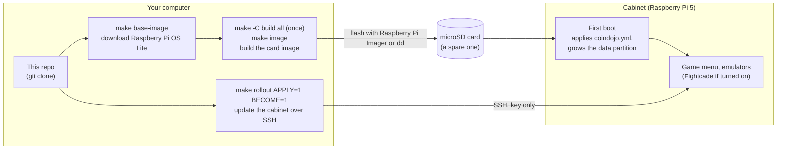
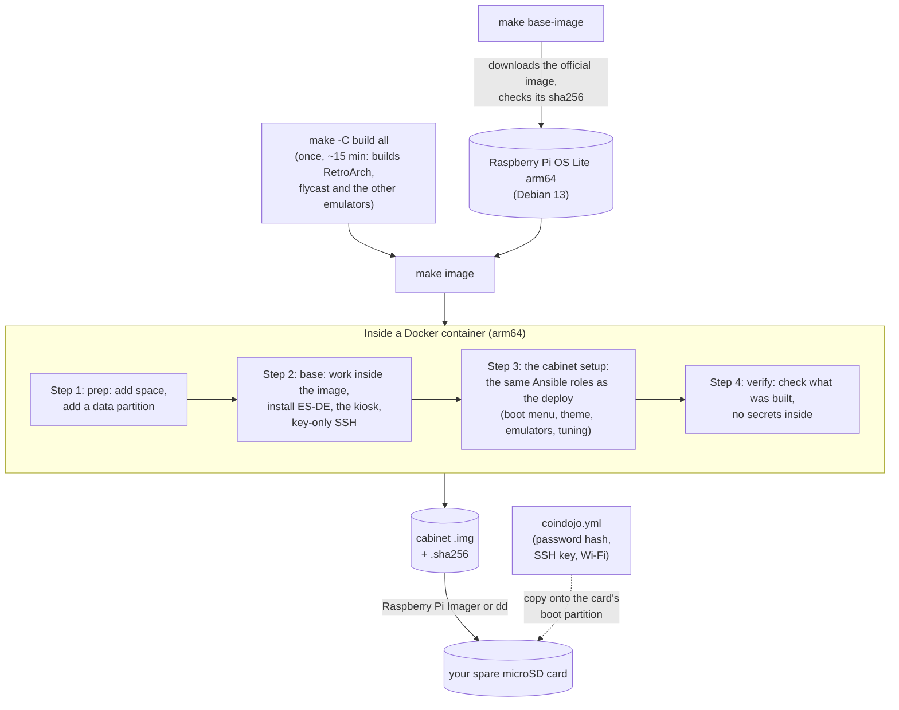
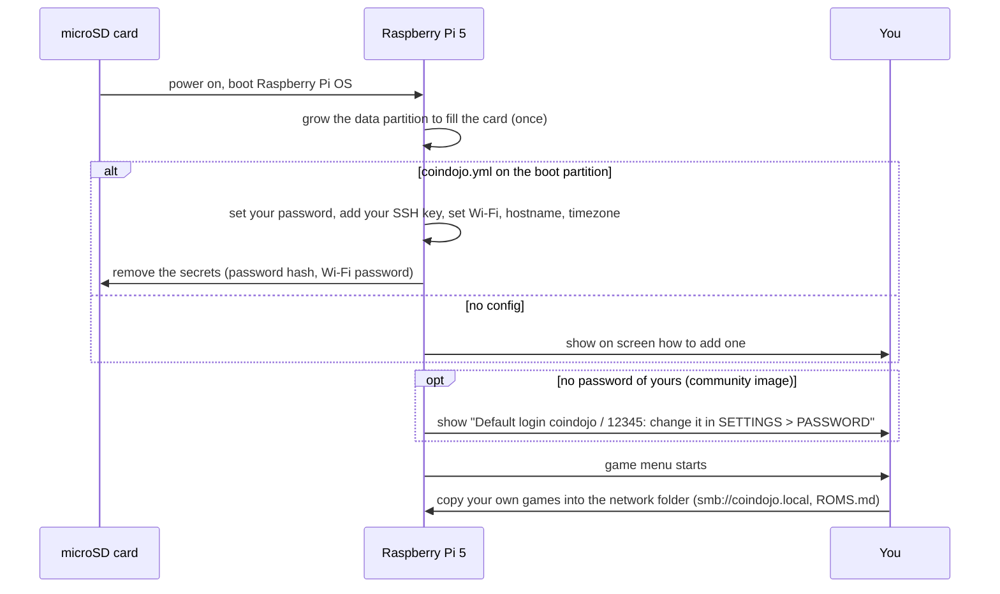
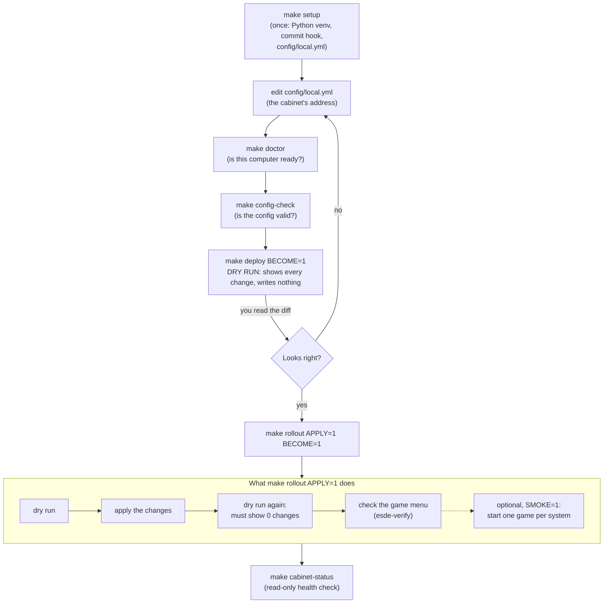
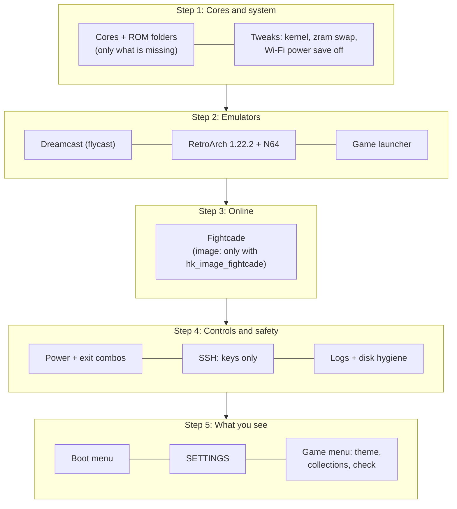

# How it works: from this repo to a cabinet

This page shows, in pictures, how the pieces fit: what each `make` command does, what runs where, and in which
order. The step-by-step guides are [BUILD.md](BUILD.md) (make a card) and [SETUP.md](SETUP.md) (deploy over SSH).

## What `make` is

`make` is a program that runs named recipes. Each recipe is a short list of commands written down in a file called
`Makefile`. You type `make image`, and it runs the commands for the `image` recipe, in the right order, with the
right settings. You never need to read the Makefile: `make help` lists every recipe in plain words.

Two rules hold for every recipe that changes something:

- **A dry run first.** Without `APPLY=1`, a recipe that would write to the cabinet only shows what it would change.
- **Your settings live in one file**, `config/local.yml` (made by `make setup`). Every value you can change is listed
  in [CONFIG.md](CONFIG.md).

Words you will meet below:

| Word | Means |
|---|---|
| dry run | a run that only shows what would change and writes nothing |
| SSH | how your computer logs in to the cabinet over your network; "key only" means with a key file, never a password |
| `BECOME=1` | lets the deploy use `sudo` on the cabinet: it asks for the cabinet's password (or reads it from your Keychain, see [SETUP.md](SETUP.md)) |
| Docker | runs the image build in a sealed-off box, so it works the same on any computer |
| Ansible, role | the tool that sets up the cabinet over SSH; a role is one part of the setup (Fightcade, the theme, ...) |
| boot partition | the small part of the card your computer can open; `coindojo.yml` goes there |
| sha256 | a fingerprint of a file, to prove it was not changed or damaged |

## The big picture

Both paths start on your computer: the image gives you a complete cabinet on a new card, and the deploy keeps a
running cabinet up to date.

- **Path 1, the image** (left to right along the top): build a card image once, flash it, boot it. The image is
  the whole cabinet: the boot menu, the game menu with its theme, SETTINGS and QUIT, RetroArch 1.22.2, flycast, the
  cores, the 4 KB-page kernel and the tuning. Fightcade is in it only if you turn it on (`hk_image_fightcade`, off by
  default). Details: [BUILD.md](BUILD.md#what-the-image-gives-today).
- **Path 2, the deploy** (the arrow at the bottom): sends the same setup to a cabinet that already runs and that you
  can reach over SSH. Every later change goes this way, so you never have to re-flash for an update. The image is
  built from the same roles as the deploy, so both give the same cabinet.

## Path 1: building the image

- Docker does the work, so the build behaves the same on any computer. On an Intel or AMD computer it emulates the
  Pi's arm64 CPU: supported, several times slower, not measured yet.
- **The system part of the image holds no passwords or keys.** Your settings go in `coindojo.yml` on the card's
  boot partition. It is applied once on the first boot, and then the password hash and Wi-Fi password are removed
  from the card. If you give your settings at build time (`CONFIG=`), that image holds them until its first boot:
  don't share it.
- **The user is fixed when you build.** Set `hk_cabinet_user` before `make image`. Do not rename it later, and
  answer **No** to Raspberry Pi Imager's OS customisation: it renames the user and the cabinet will not start.
- A build takes about 6 to 8 minutes on the tested Mac, plus the one-time `make -C build all`
  ([BUILD.md](BUILD.md) has the measured numbers).
- The image is sized for a 16 GB card at least. On the first boot the games partition grows to fill whatever card
  you use (32 GB recommended).

## First boot on the cabinet

- **The default login.** If your `coindojo.yml` sets no password, the image's user is `coindojo` with password
  `12345` (#265). Every boot shows that line until you change it in SETTINGS > PASSWORD (it sets the network
  folder's password too). Until then `12345` also opens the network folder (`roms`, `bios`) from the cabinet's local
  subnets. SSH still takes only your key. Admin (`sudo`) is off on the community image (#270): only a `password_hash` in `coindojo.yml` on
  the SD card turns it on at boot; changing the password on the running cabinet (SETTINGS > PASSWORD, `passwd`) does not.

## Path 2: deploying over SSH

The deploy uses Ansible: a tool that connects to the cabinet over SSH and makes it match a written description
(the "roles" in `ansible/`). `make rollout` checks that it is done: it runs the dry run a second time and fails if anything would still change.

What the deploy installs, in order (each one is a role; `TAGS=` runs only some of them, one per role, see [ansible/README.md](../ansible/README.md)):

The image runs the same roles in the same order, with three differences: `sshd_keyonly` is skipped (the build
writes the key-only SSH setting itself), `esde_verify` is skipped (it needs a running game menu), and Fightcade is
included only if `hk_image_fightcade` is on.

## Which `make` command when

| I want to... | Run | Changes anything? |
|---|---|---|
| Get ready, once | `make setup`, then `make doctor` | your computer only |
| Download the base OS | `make base-image` | your computer only |
| Build a card image | `make image` (after `make -C build all`, once) | your computer only |
| Check my settings | `make config-check`, `make config` | no |
| See what a deploy would change | `make deploy BECOME=1` | no (dry run) |
| Install or update the cabinet | `make rollout APPLY=1 BECOME=1` | **yes, the cabinet** |
| Only one part (for example the theme) | `make deploy TAGS=esde_theme BECOME=1`, then add `APPLY=1` | **yes, with APPLY=1** |
| Check the cabinet's health | `make cabinet-status` | no |
| Restart the game menu | `make esde-restart APPLY=1` | **yes, the cabinet** |
| Try a change safely first | `make vm-up`, `make vm-provision` | a test VM on your computer |
| Run the tests | `make test` | no (takes a while) |

Every command and its options: [REFERENCE.md](REFERENCE.md), or `make help`.
